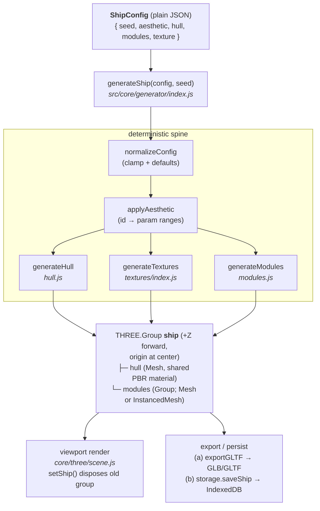
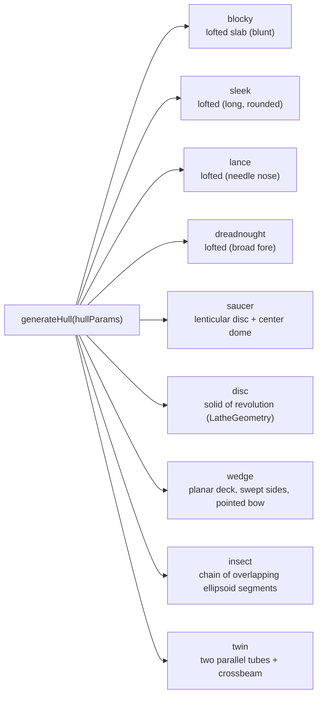

# Ship Foundry

A **purely client-side procedural starship generator**. Ships are generated
entirely in the browser — no backend, no network — and can be tuned per-aspect on
dedicated harness pages, saved to browser storage, and exported as GLTF/GLB.

- Ships are **frigates and larger**, with their **forward axis on +Z** and origin
  at the ship's center.
- **9 hull archetypes** built from genuinely different base geometries (lofted
  slabs, lenticular saucers, solids-of-revolution discs, wedges, segmented
  arthropods, twin-tube composites).
- A variety of **design aesthetics** (original design languages inspired by
  popular sci-fi universes — not trademarked assets).
- **Procedurally generated textures** (canvas-based, baked into the export).
- **IndexedDB** persistence for ships and presets.
- Ships are **deterministic**: the same config + seed always reproduces the same
  ship (all randomness is seeded; no `Math.random` in the generator).
- **MIT** licensed.

## Stack

| Concern     | Choice                                             |
| ----------- | -------------------------------------------------- |
| Language    | JavaScript (ESM)                                   |
| Build       | Vite (SPA, `base: './'` for host-agnostic output)  |
| Styling     | Tailwind CSS v4 + DaisyUI v5                       |
| Icons       | Lucide (swapped in after each render)              |
| 3D          | three.js (+ `GLTFExporter` from `examples/jsm`)    |
| Persistence | IndexedDB (thin custom wrapper in `src/persistence`) |
| Routing     | Single-page app + hash routing (no router library) |

## Getting started

```bash
npm install
npm run dev        # start the dev server (http://localhost:5173)
```

Open http://localhost:5173 — the main app loads with a placeholder ship. Hit
**Randomize** to roll a new ship, or pick a design language from the aesthetic
selector to re-roll the hull/modules/texture within that language's ranges.

Other scripts:

```bash
npm run build      # production build to dist/
npm run preview    # serve the production build
npm run lint       # eslint
```

## How it works

### Data flow

Everything is derived from one plain-JSON `ShipConfig` + a seed. The ship is
never stored as geometry — it is always regenerated from config, so a saved ship
round-trips perfectly.



The same `generateShip(config, seed)` is the single code path for the main app,
every harness preview, export, and reload. Determinism is therefore guaranteed
everywhere at once (see [ARCHITECTURE.md §6](docs/ARCHITECTURE.md#6-determinism-no-mathrandom-and-the-performance-budget-sp-11)).

### Hull archetypes

Each archetype is built from *actually different* base geometries, not one
lofted tube with different taper curves. They all fit the length/beam/height
envelope and expose the same surface anchors so superstructure placement works
uniformly across every body type.



### The 9 hull archetypes

| Archetype     | Base geometry                                            | Character                              |
| ------------- | -------------------------------------------------------- | -------------------------------------- |
| `blocky`      | lofted slab (Catmull-Rom profile, blunt)                 | hard-surface military                  |
| `sleek`       | lofted (long, rounded profile)                           | colonial / corporate                   |
| `lance`       | lofted (needle-nose profile)                             | fast attacker                          |
| `dreadnought` | lofted (broad fore profile)                              | ornate warship                         |
| `saucer`      | lenticular disc + center dome                            | classic flying saucer                  |
| `disc`        | **solid of revolution** (LatheGeometry, 2D profile revolved around Y, then aligned to Z) | disc with convex/concave upper & lower curves + cylinder/frustum edge |
| `wedge`       | planar deck keel, swept sides, pointed bow               | capital-ship silhouette                |
| `insect`      | chain of overlapping ellipsoid segments (head/thorax/abdomen + dorsal/ventral carapace) | arthropod                            |
| `twin`        | two parallel hull tubes + a connecting crossbeam         | split double-hull                      |

### Design aesthetics

8 original design languages parameterize the hull, module, and texture aspects.
Applying one fills the three sub-objects of a `ShipConfig` with concrete values
resolved from the aesthetic's parameter **ranges** via the seeded rng.

| Aesthetic   | Label      | Character                                                        |
| ----------- | ---------- | ---------------------------------------------------------------- |
| `hardpoint` | Hardpoint  | hard-surface military, grey-white, strong panel lines            |
| `sleek`     | Sleek      | clean colonial/corporate, white & light-grey, subtle wear        |
| `organic`   | Organic    | biopunk, dark hulls, greeble-heavy, bioluminescent glow          |
| `retro`     | Retro      | retro-futurism, chrome, bold accent bands, atomic-age flair      |
| `gothic`    | Gothic     | ornate dreadnought, tall dark silhouette, prominent spires       |
| `minimal`   | Minimal    | monolithic minimalist, smooth matte, very few modules            |
| `blocky`    | Blocky     | modular industrial freighter, boxy, heavy paneling, cargo hangar |
| `placeholder` | Standard | generic baseline (default until a design language is chosen)     |

## Routes

| Route             | View                                              |
| ----------------- | ------------------------------------------------- |
| `#/`              | main application (viewport, controls, save, export) |
| `#/harness`       | index of all tuning harnesses                     |
| `#/harness/:id`   | a single tuning harness (e.g. `#/harness/hull`)   |

### The 5 harnesses

Each harness isolates one aspect of the generator, with a live preview and a
save-to-config path:

| `:id`       | Harness    | What it tunes                                            |
| ----------- | ---------- | -------------------------------------------------------- |
| `hull`      | Hull       | hull geometry (archetype, length, beam, tapers, sections) |
| `modules`   | Modules    | the superstructure (density + per-module counts/sizes)   |
| `textures`  | Textures   | procedural surface (palette, panel lines, greebles, wear, stripes, emblem, size) |
| `aesthetics`| Aesthetics | pick a design language; re-rolls hull/modules/texture within its ranges |
| `export`    | Export     | export the live ship as GLB or GLTF, or copy the config JSON |

## Conventions & persistence

- **+Z is forward**; the ship's origin is its center. The default camera sits on
  the −Z side, so the nose points away from the camera.
- **IndexedDB** stores: `ships` (saved `ShipRecord`s) and `presets` (named config
  presets from the harnesses). A saved ship's `config` + `seed` are the source of
  truth — the ship is always regenerated from them on load; thumbnails and stats
  are caches only.
- **No WebGL leaks**: every view disposes its WebGL context on unmount, so
  navigating between the main app and the harnesses never accumulates contexts.

## Docs

- **[ARCHITECTURE.md](docs/ARCHITECTURE.md)** — data flow, the `ShipConfig`
  model, module map, +Z convention, persistence, the harness pattern, and how to
  add a new aspect or a new harness.
- **[PLAN.md](docs/PLAN.md)** — the meta-plan: invariants, sub-plans, and the
  locked stack.
- **[plans/](docs/plans/)** — per-sub-plan detail.

## License

[MIT](./LICENSE)
